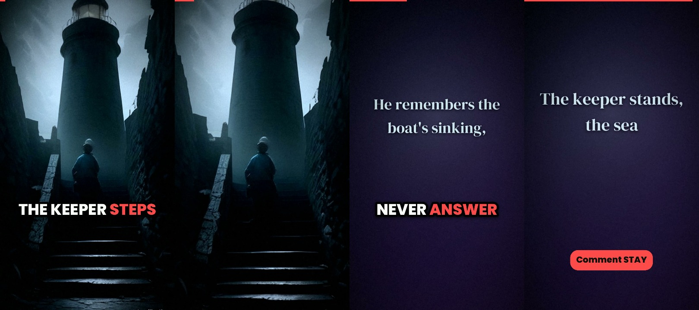
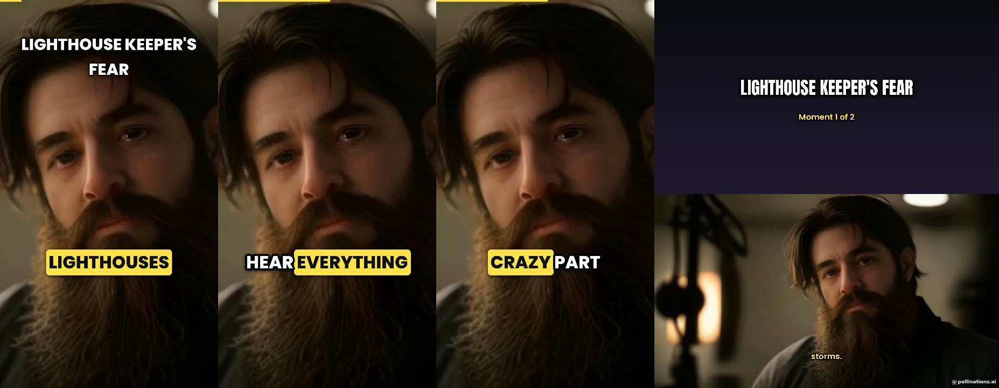
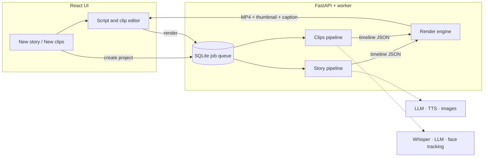

<div align="center">

# KathaCut

**A zero-cost AI video studio. Turn an idea, a PDF or a long video into captioned, ready-to-post shorts.**

*katha* (कथा / ಕಥೆ) = story &nbsp;·&nbsp; *cut* = the edit


</div>

KathaCut is one self-hosted web app with two pipelines that share a single render engine:

| | Story Studio | Clip Studio |
|---|---|---|
| **Input** | A one-line idea, pasted text, or a PDF | A video file or a YouTube link |
| **What it does** | Writes hook-first scripts, narrates them, illustrates every scene in one art style, animates and captions | Transcribes, ranks the strongest moments, tracks the speaker's face into a vertical frame, captions |
| **Output** | 9:16 shorts, a multi-part series, an optional long 16:9 video | 9:16 / 1:1 / 4:5 clips with hook titles, plus a 16:9 best-of cut |

Everything runs on free tiers and on your own computer. You review and edit every script and every clip
boundary before anything is rendered.

## Preview

**Story Studio** — frames from a 27-second short rendered from a single-sentence idea:



**Clip Studio** — a face-tracked vertical clip with box captions, and the 16:9 best-of cut:



## Features

**Story Studio**
- Three sources: an idea, pasted text, or a PDF (pictures inside the PDF are extracted and reused as visuals)
- Six tones (horror, mythology, mystery, documentary, facts, folk tale) with retention-shaped scripts: a hook of
  at most 12 words, escalation, a payoff, and a question for the comments
- Seven art styles, including Tholu Bommalata shadow puppet, dark ink horror and paper-cut diorama, each with
  its own colour grade, grain and caption colour
- **Series mode**: one story in parts, each ending on a cliffhanger and a "comment A or B" choice
- **Grounded mode** for documents: every scene cites its source page, and facts the app cannot find on that
  page are flagged for you to check
- A character and world "bible" keeps illustrations consistent between scenes
- Narration in English, Hindi, Kannada, Telugu and Tamil voices
- Ken Burns motion with a new shot every few seconds, even inside one scene

**Clip Studio**
- Word-level transcription, then an LLM editor picks self-contained moments and scores them; loud, energetic
  passages get a boost
- Face-tracked reframing with shot-cut detection, camera smoothing, and a blurred-fit fallback when two
  speakers sit too far apart for one vertical crop
- Frame-accurate cuts, a hook title for the first three seconds, a progress bar
- One-click 16:9 best-of cut with title cards

**Both**
- Four animated caption styles with per-word highlighting
- A script and clip editor: change any line, picture prompt, label or boundary, or upload your own image
- A job queue that survives restarts, with live progress
- A ready-to-paste post caption with hashtags, source pages and an AI-disclosure reminder
- A "free quota used today" table so you can see what each provider has served

## Quick start

You need **Python 3.11+** and **Node 18+**. FFmpeg is bundled.

**Windows**

```powershell
git clone https://github.com/HSSHREYAS/kathacut.git
cd kathacut
powershell -ExecutionPolicy Bypass -File setup.ps1
.\run.ps1
```

**Linux / macOS**

```bash
git clone https://github.com/HSSHREYAS/kathacut.git
cd kathacut
./setup.sh
./run.sh
```

Open **http://localhost:8000**.

> On Windows, keep the project in a short path such as `C:\kathacut`. Very long paths stop some libraries
> from loading.

The first render downloads the voice model (about 350 MB) and a few fonts into `data/`.

## Free API keys

Paste keys on the **Settings** page inside the app, or put them in `.env`. None of them needs a card.

| Key | What it unlocks | Get it |
|---|---|---|
| `GEMINI_API_KEY` | The best script writing and moment picking | [aistudio.google.com/apikey](https://aistudio.google.com/apikey) |
| `GROQ_API_KEY` | Very fast Whisper transcription and a second LLM | [console.groq.com/keys](https://console.groq.com/keys) |
| `CLOUDFLARE_ACCOUNT_ID` + `CLOUDFLARE_API_TOKEN` | Fast FLUX images (the token needs the Workers AI permission) | [dash.cloudflare.com](https://dash.cloudflare.com) |
| `PIXABAY_API_KEY` | Stock photos when AI images fail | [pixabay.com/api/docs](https://pixabay.com/api/docs/) |
| `OPENROUTER_API_KEY` | An optional extra LLM fallback | [openrouter.ai/keys](https://openrouter.ai/keys) |

**It also runs with no keys at all**, using a local voice, local Whisper, [Ollama](https://ollama.com) and a
keyless image service. That mode is slower and writes weaker scripts, and the keyless image service allows
one image every 45 seconds. Gemini and Cloudflare keys make the biggest difference.

Every stage has a fallback chain, and model names are never hard-coded: the app asks each provider which
models your key can use and picks the best one.

| Stage | Order tried |
|---|---|
| Writing and ranking | Gemini → Groq → OpenRouter → Ollama |
| Transcription | Groq Whisper → faster-whisper (local) |
| Narration | Kokoro (local) ↔ Edge voices |
| Images | PDF figure / your upload → Cloudflare FLUX → Pollinations → Pixabay → generated title card |

## How it works



The key design decision is the **timeline JSON**. Both studios describe a video the same way, and one
renderer turns it into frames, so every new caption style, overlay or transition works for both.

```json
{
  "width": 1080, "height": 1920, "fps": 30,
  "scenes": [
    { "duration": 4.2,
      "visual": { "type": "image", "src": "scene1.jpg", "motion": "zoom_in", "grade": "cold" },
      "transition": "fade",
      "overlays": [{ "type": "pill", "text": "Part 1 of 7" }] },
    { "duration": 12.0,
      "visual": { "type": "video", "src": "clip.mp4",
                  "crop": { "mode": "track", "keys": [[0, 0.62], [12, 0.58]] } } }
  ],
  "captions": { "style": "pop", "highlight": "#FFE14A",
                "words": [{ "w": "Nobody", "t0": 0.10, "t1": 0.42 }] },
  "audio": { "tracks": [{ "src": "narration.wav" }], "music": { "src": "bed.mp3", "volume": 0.12 } },
  "look": { "vignette": 0.5, "grain": 0.06, "progress_bar": "#FFE14A" }
}
```

The renderer composites frames in Python (OpenCV, NumPy, Pillow) and pipes them to FFmpeg, using NVENC when
an NVIDIA GPU is present and x264 otherwise.

### Project layout

```
backend/app/
  main.py              API, file serving, serves the built UI
  worker.py            job worker (SQLite queue, resumes after a restart)
  config.py  db.py     settings, projects, jobs, usage log
  ffutil.py            FFmpeg discovery, probing, encoder choice
  render/
    engine.py          timeline JSON -> MP4
    captions.py        caption styles and word paging
    text.py            text sprites and alpha blending
  providers/
    llm.py             provider router with model discovery and cooldowns
    tts.py  stt.py     voices and transcription
    images.py          image providers and caching
  pipelines/
    story.py           plan -> script -> narration -> images -> timeline
    pdfparse.py        PDF text and figure extraction
    clips.py           transcript -> ranked moments -> clips and best-of
    reframe.py         face tracking and crop tracks
    youtube.py         link download
frontend/src/          React + Vite UI
data/                  created at first run: projects, models, fonts, cache, settings
```

## Deploying

**1. Your computer plus a public link (recommended).** Rendering wants a real CPU or GPU, and YouTube blocks
cloud servers, so the worker belongs on your own machine. Set `APP_PASSWORD` in `.env`, start the app, then:

```bash
cloudflared tunnel --url http://localhost:8000
```

**2. Cloud UI, local worker.** Host `frontend/` on Vercel or Cloudflare Pages (build `npm run build`, output
`dist`) with `VITE_API_BASE` set to your tunnel URL. The UI shows "Worker offline" while your computer is off.

**3. One container.**

```bash
docker build -t kathacut .
docker run -p 7860:7860 -e APP_PASSWORD=change-me -v kathacut-data:/app/data kathacut
```

The same Dockerfile works as a Hugging Face Docker Space (port 7860) or on any VM. On cloud hosts, upload
files instead of using YouTube links, and expect slow CPU renders.

## What has been verified

Tested on Windows 11 with an RTX 3050 laptop GPU:

| Path | Result |
|---|---|
| Idea → script → narration → images → 1080×1920 short | Works; a 27 s short rendered in 47 s |
| 138-page PDF → digest → script → short | Works with local Ollama; 151 figures extracted |
| Uploaded video → transcript → picks → face-tracked clips + best-of | Works; two clips and a best-of in 47 s |
| YouTube link → 5 rendered clips | Works from a home connection |
| Web UI, `setup.ps1`, `run.ps1` | Work from a clean folder |
| Gemini, Groq, Cloudflare, Pixabay, OpenRouter | Written, **not yet run with real keys** |
| Docker image | Written, **not yet built** |

Known limits:
- Captions in Indian scripts do not shape correctly on Windows yet. Use Hinglish captions or switch captions off.
- Caption timing for the local voice is estimated per sentence, not force-aligned.
- Small local LLMs write weak scripts and may return fewer videos than requested.

See [BUILD_STATUS.md](BUILD_STATUS.md) for the roadmap.

## Use it responsibly

- Clip only your own videos or ones you have permission to use. Re-uploading someone else's video without
  adding anything is not fair use and is not monetisable.
- For PDFs, use public-domain or your own documents, and check the credit line of pictures inside them.
- Switch on the platform's AI label when a video uses AI narration or AI images.
- Read every script before posting. A red "check this fact" chip means the app could not find those names
  or numbers on the cited page.
- Downloading from YouTube may conflict with its Terms of Service. File upload is always available.

## Extras

- **Background music:** drop mp3 files in `data/music`, then choose one under "Look and voice".
- **Sign-in or age-restricted videos:** export `cookies.txt` from your browser into `data/`.
- **Force CPU encoding:** set `KATHACUT_ENCODER=cpu`.
- **Move the data folder:** set `KATHACUT_DATA=/some/path`.

## Built with

[FastAPI](https://fastapi.tiangolo.com) · [React](https://react.dev) + [Vite](https://vite.dev) ·
[FFmpeg](https://ffmpeg.org) · [OpenCV](https://opencv.org) (YuNet face detection) ·
[Kokoro](https://github.com/thewh1teagle/kokoro-onnx) · [edge-tts](https://github.com/rany2/edge-tts) ·
[faster-whisper](https://github.com/SYSTRAN/faster-whisper) · [pypdfium2](https://github.com/pypdfium2-team/pypdfium2) ·
[yt-dlp](https://github.com/yt-dlp/yt-dlp)
